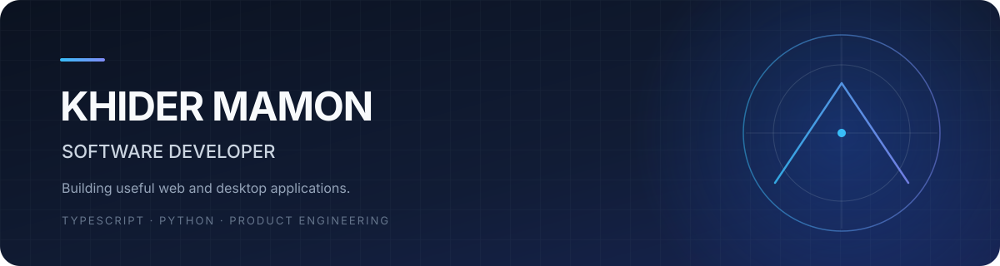

<!-- Profile README: github.com/khdrgdo -->

  

  <strong>Software Developer</strong> · Web & Desktop Applications · Product-minded Engineering
   
  أبني حلولاً برمجية عملية، وأهتم بجودة التنفيذ وتجربة المستخدم.

  
  
  
  

---

## About

I build software projects that solve practical problems, from web platforms to desktop business applications. My work focuses on clear interfaces, useful workflows, and systems that are easier to maintain and improve.

- **Application development:** web platforms and desktop tools.
- **Product thinking:** turning requirements into structured, usable features.
- **Engineering priorities:** readable code, reliable workflows, and thoughtful UX.
- **Languages I work with:** TypeScript and Python.

## Featured work

| Project | What it is |
| --- | --- |
| [Al-Omrabi School](https://github.com/khdrgdo/al-umrabischool) | A school-management platform project focused on academic operations and student/guardian workflows. |
| [KHAC](https://github.com/khdrgdo/khac) | A learning-platform project covering course management, role-based teacher access, and student communication. |
| [Cure Enterprise](https://github.com/khdrgdo/cure-enterprise) | A Python desktop pharmacy-management system with point of sale, inventory, accounting, and reporting workflows. |
| [Khiders Creative Hub](https://github.com/khdrgdo/khiders-creative-hub) | A personal portfolio and content-platform project with an Arabic-first, editorial direction. |

## How I work

- Start with the real problem and the people using the software.
- Prefer maintainable solutions over unnecessary complexity.
- Treat accessibility, security, and data integrity as part of the product.
- Document decisions so projects remain understandable as they grow.

## Collaboration

I'm open to meaningful collaboration on **education technology, business software, Arabic-first products, and practical developer tools**.

If you maintain a project in these areas, feel free to open an issue or start a discussion. I’m also interested in contributing to well-maintained open-source projects.

---

  Build with purpose. Improve with evidence.

